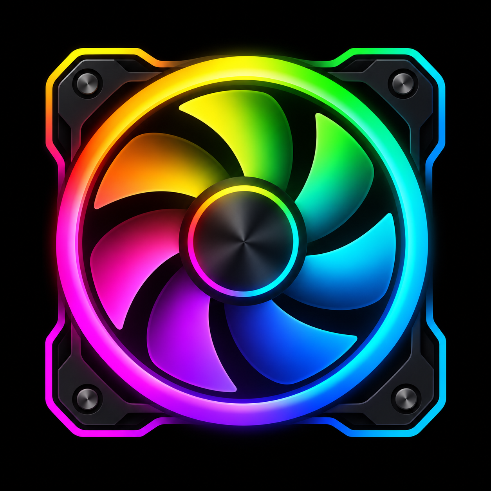

  

<h1 align="center">FanSetup</h1>

  A native macOS app for monitoring temperatures and controlling your Mac's fans. 
  Ứng dụng macOS native để theo dõi nhiệt độ và điều khiển quạt trên máy Mac.

  <a href="#-english">English</a> · <a href="#-tiếng-việt">Tiếng Việt</a>

---

## 🇬🇧 English

FanSetup is a lightweight, native macOS app that shows what is happening inside your Mac and lets you take control of its fans — without an account, cloud service, or telemetry.

### What you can do

- **Monitor in real time** — CPU, GPU, and other temperature sensors, thermal pressure, and each fan's minimum, current, and maximum RPM.
- **Explore every sensor** — search and filter sensors by category, view live values, and see a history chart for each one.
- **Control fans your way** — choose Automatic, drag a fixed RPM slider, use 25 / 50 / 75 / 100% presets, or go Full Blast. Reset one fan or all fans to Automatic at any time.
- **Automate with conditions** — set simple rules like "when temperature is ≥ 80 °C → run at 4,000 RPM". FanSetup falls back to Automatic when the temperature drops or a sensor disappears.
- **Save profiles** — create, rename, duplicate, and activate fan setups for different situations (quiet work, heavy load, gaming, and so on).
- **Check from the menu bar** — see the live CPU temperature next to the fan icon, switch profiles, reset fans, or open the dashboard in one click.
- **Make it yours** — Celsius or Fahrenheit, decimal precision, refresh interval, launch at login, and an optional Dock icon.

### Safe and private by design

- Fan speeds are always kept inside the range reported by your Mac's hardware.
- On Macs that do not support fan control, FanSetup automatically works in **monitoring-only** mode.
- Everything runs locally: no account, no cloud sync, no telemetry, and no persistent activity logs.
- **Reset All to Automatic** — or **Quit FanSetup** from the menu bar — hands the fans back to macOS.

### Requirements

- macOS 15.0 or later
- Apple Silicon or Intel Mac
- Administrator approval to install the fan control helper (only needed for fan control)
- Xcode 16 or later (only if you want to build from source)

### Download

Get the latest version from the **Releases** page:

**→ [Download FanSetup](https://github.com/daihieptn97/fan-setup/releases)**

> Fan control relies on hardware interfaces that are not publicly documented by Apple. Support varies by Mac model, and unsupported models remain monitoring-only.

### Need help?

Questions, bug reports, or feedback? Contact us on Facebook:

**https://www.facebook.com/profile.php?id=61595176387796**

---

## 🇻🇳 Tiếng Việt

FanSetup là ứng dụng macOS native, nhẹ và dễ dùng, giúp bạn theo dõi tình trạng bên trong máy Mac và điều khiển quạt — không cần tài khoản, không dùng cloud, không thu thập dữ liệu.

### Bạn có thể làm gì

- **Theo dõi theo thời gian thực** — nhiệt độ CPU, GPU và các cảm biến khác, trạng thái nhiệt của hệ thống, cùng tốc độ tối thiểu, hiện tại và tối đa của từng quạt.
- **Xem mọi cảm biến** — tìm kiếm, lọc theo nhóm, xem giá trị trực tiếp và biểu đồ lịch sử của từng cảm biến.
- **Điều khiển quạt theo ý muốn** — chọn Tự động (Automatic), kéo thanh trượt tốc độ cố định, dùng mức nhanh 25 / 50 / 75 / 100%, hoặc chạy tối đa (Full Blast). Trả một quạt hoặc tất cả quạt về Tự động bất cứ lúc nào.
- **Tự động hóa theo ngưỡng nhiệt** — tạo quy tắc đơn giản như "khi nhiệt độ ≥ 80 °C → chạy 4.000 RPM". Khi nhiệt độ giảm hoặc cảm biến mất, FanSetup tự trả quạt về chế độ Tự động.
- **Lưu cấu hình (Profile)** — tạo, đổi tên, nhân bản và kích hoạt các bộ cài đặt quạt cho từng tình huống: làm việc yên tĩnh, tải nặng, chơi game...
- **Theo dõi từ menu bar** — xem nhiệt độ CPU ngay cạnh icon quạt, chuyển profile, trả quạt về Tự động hoặc mở Dashboard chỉ với một cú nhấp.
- **Tùy chỉnh linh hoạt** — đơn vị °C hoặc °F, số chữ số thập phân, chu kỳ làm mới, tự khởi động cùng máy, và tùy chọn ẩn icon Dock.

### An toàn và riêng tư

- Tốc độ quạt luôn được giới hạn trong dải an toàn do phần cứng máy Mac báo về.
- Trên máy không hỗ trợ điều khiển quạt, FanSetup tự chuyển sang chế độ **chỉ theo dõi** (monitoring-only).
- Mọi dữ liệu xử lý cục bộ: không tài khoản, không đồng bộ cloud, không telemetry, không lưu log hoạt động.
- Bấm **Reset All to Automatic** — hoặc **Quit FanSetup** từ menu bar — để trả quạt lại cho macOS quản lý.

### Yêu cầu

- macOS 15.0 trở lên
- Máy Mac chip Apple Silicon hoặc Intel
- Quyền quản trị để cài helper điều khiển quạt (chỉ cần khi muốn điều khiển quạt)
- Xcode 16 trở lên (chỉ cần nếu tự build từ mã nguồn)

### Tải xuống

Tải phiên bản mới nhất tại trang **Releases**:

> Điều khiển quạt dựa trên giao diện phần cứng không được Apple công bố chính thức. Khả năng hỗ trợ tùy theo từng dòng máy; các máy không tương thích sẽ chỉ theo dõi được nhiệt độ.

### Cần hỗ trợ?

Bạn có câu hỏi, muốn báo lỗi hoặc góp ý? Liên hệ với chúng tôi qua Facebook:

**https://www.facebook.com/profile.php?id=61595176387796**
